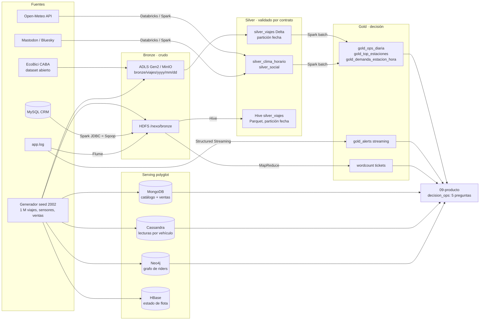

# Arquitectura medallion — NexoUrbano (squad 2002)

## Cada V → un motor

| V | Dónde aparece en NexoUrbano | Motor | Por qué ese y no otro |
|---|---|---|---|
| **Volumen** | 1 M viajes (160 MB) que crecen todos los días | **Spark** sobre Delta/Parquet particionado por fecha (+ HDFS/ADLS como almacenamiento barato) | Escala horizontal, poda de particiones y broadcast join (ver `05-spark/batch/explain.txt`) |
| **Variedad** | CSV de viajes, JSON anidado de catálogo, texto libre de tickets y redes, grafo social | **MongoDB** (documentos), **MapReduce** (texto), **Neo4j** (relaciones) | Cada forma de dato en el motor que la modela sin forzarla a tablas |
| **Velocidad** | Eventos de app y telemetría que importan en minutos | **Structured Streaming** (ventanas + watermark) y **Cassandra** (escritura y lectura por vehículo en ms) | Alertas en ventana de 2 min; última lectura por partición sin scans |
| **Veracidad** | Viajes absurdos, duplicados, eventos tardíos, bots | **Contrato YAML + Spark** (rechazos con motivo), **watermark**, perfilado versionado | La calidad es código: 2,0 % del Bronze rechazado con motivo en `silver_viajes_rechazos` |

## Capas

| Capa | Dónde | Qué garantiza |
|---|---|---|
| Bronze | ADLS `bronze/` (o MinIO), HDFS `/nexo/bronze` | Dato tal cual llegó, particionado por día de ingesta. Nunca se edita |
| Silver | `lake/silver` (Delta), Hive `nexo.silver_viajes` | Cumple `contratos/*.yaml`: tipos, claves únicas, reglas de rechazo |
| Gold | `lake/gold`, `09-producto/ventas_agg.json`, `04-hadoop/mapreduce/output` | Tablas de decisión con grano de negocio (día, estación × hora, ventana) |
