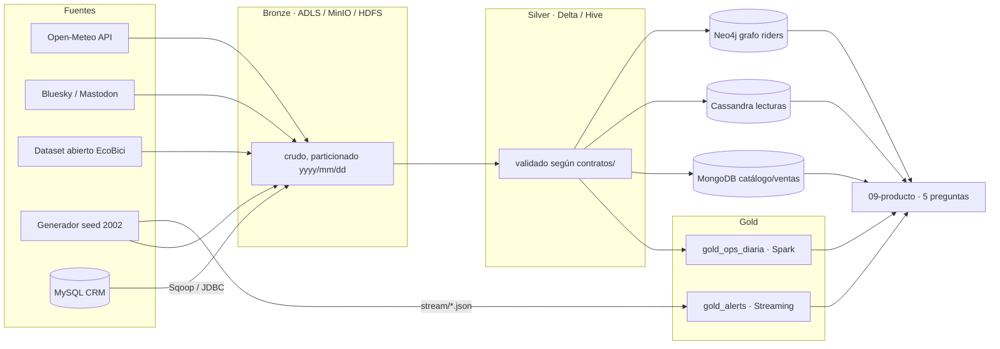

# Arquitectura medallion — NexoUrbano

## Cada V → un motor

| V | Dónde aparece en NexoUrbano | Motor que la resuelve | Por qué |
|---|---|---|---|
| Volumen | | | |
| Variedad | | | |
| Velocidad | | | |
| Veracidad | | | |
